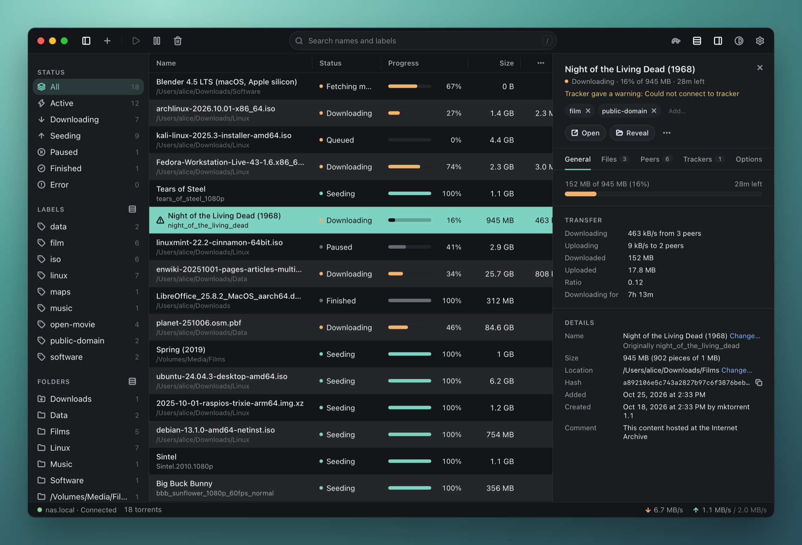
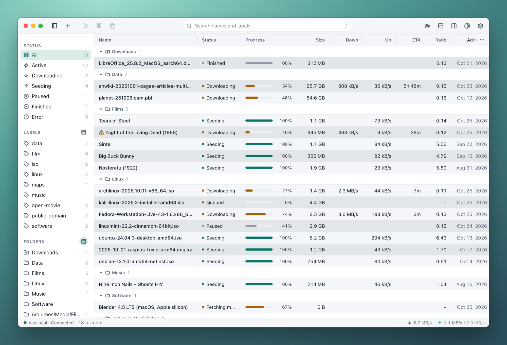
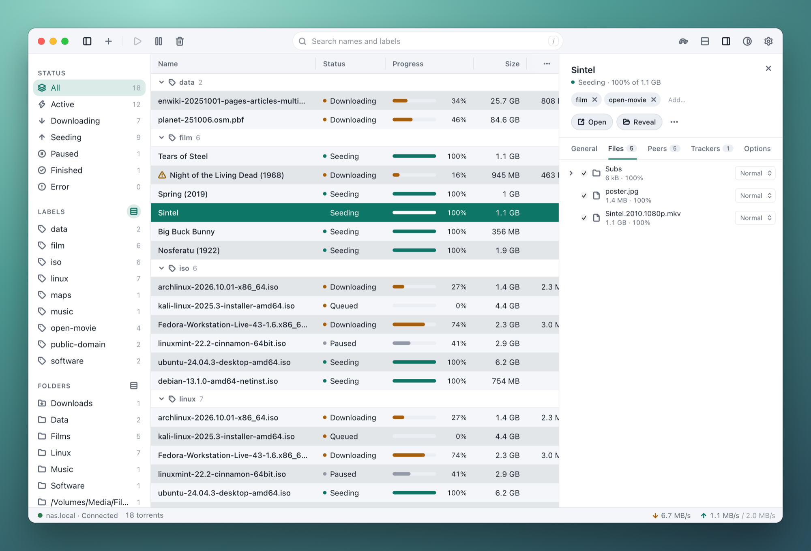

<p align="center">
  
</p>

<h1 align="center">Transceiver</h1>

<p align="center">A desktop client for <a href="https://transmissionbt.com">Transmission</a>, for macOS and Linux.</p>



Transceiver connects to a Transmission running somewhere else (a NAS, a home server, a seedbox) and gives it a native
desktop app in place of the web interface: a fast table of your torrents, an inspector for the one you're looking at, a
menu bar or tray icon, and the little things that make it pleasant to use every day. It's built with Tauri, Rust and
SolidJS, so it's small and quick.

## Features

- **Live torrent table.** Sort by any column, and resize, reorder and hide columns. Expanded rows add a second line under
  each name: its original name, its folder or its labels.
- **Inspector.** Progress and transfer details, files (choose which to download and their priority), peers, trackers and
  per-torrent options. Rename a torrent, move it to another folder, or open and reveal it on this computer.
- **Labels.** Add and remove them on several torrents at once, and rename or delete one everywhere. Filter by label,
  or group the table by label.
- **Folders.** Filter and group by the folder each torrent downloaded to, named relative to Transmission's download
  folder.
- **Original names.** A renamed torrent still shows what it was called, read from Transmission's own copy of its
  `.torrent` file, wherever it was renamed.
- **Adding torrents.** Magnet links and `.torrent` files: paste them, drop them on the window, or open them from your
  browser and file manager. Choose the folder (with favourites and recents), labels and whether to start, and see the
  free space first.
- **Transmission's settings.** Speed limits and the alternative speeds ("turtle") with its schedule, queues, seeding
  limits, peers, port forwarding with a port test, encryption and the blocklist.
- **Menu bar and tray.** Speeds at a glance, pause or resume everything, add a magnet from the clipboard. Notifications
  when downloads finish, launch at login, and a shortcut to bring the window forward.
- **Themes.** Light and dark, plus Sepia, Catppuccin and Dracula, with accent colours and an adjustable interface size.
- **Keyboard shortcuts** for nearly everything (Settings › Keyboard Shortcuts lists them).

| Grouped by folder | A torrent's files |
| --- | --- |
|  |  |

## Requirements

- **Transmission 4.1 or newer** on the host. Transceiver speaks Transmission's current JSON-RPC protocol, which 4.0 and
  earlier don't have; it tells you so if it connects to one.
- **macOS 13 or newer**, or **Linux** with WebKitGTK 4.1. It's used daily on macOS and on CachyOS with KDE Plasma
  (Wayland). On Linux, the tray icon needs `libayatana-appindicator`; without it, Transceiver runs with no tray icon.
- **Optional:** your download folders shared to this computer (SMB, NFS and so on), for Open and Reveal and for original
  names. Settings › Paths says where each of the host's folders is mounted.

Windows isn't supported yet.

## Install

Download it from the [latest release](https://github.com/obscuredetour/xcvr/releases/latest):

- **macOS:** the `aarch64.dmg` for Apple silicon, or the `x64.dmg` for Intel. Transceiver isn't
  notarized by Apple, so the first time you open it, macOS says it can't verify it: open System
  Settings › Privacy & Security and choose **Open Anyway**.
- **Linux:** the `.AppImage`, or the `.deb` or `.rpm` for your distribution.
- **Arch Linux and CachyOS:** a `PKGBUILD` in [packaging/aur](packaging/aur/README.md) installs the
  release with `makepkg -si`.

Installed from these, Transceiver keeps itself up to date (Settings › About); the Arch package is
updated through pacman instead. Or build it yourself (below).

## Build

You need [Rust](https://rustup.rs) 1.88 or newer, [Node.js](https://nodejs.org) with
[pnpm](https://pnpm.io/installation), and the Tauri CLI:

```bash
cargo install tauri-cli
```

On Linux, also the system libraries Tauri uses. On Arch and CachyOS:

```bash
sudo pacman -S --needed base-devel webkit2gtk-4.1 openssl librsvg libayatana-appindicator xdotool
```

On Debian and Ubuntu:

```bash
sudo apt install build-essential libwebkit2gtk-4.1-dev libssl-dev librsvg2-dev libayatana-appindicator3-dev libxdo-dev
```

Then build it:

```bash
git clone https://github.com/obscuredetour/xcvr.git
cd xcvr/crates/app/ui && pnpm install
cd .. && cargo tauri build
```

The app lands in `target/release/bundle/`: `macos/Transceiver.app` (and a `.dmg`) on macOS, or a `.deb`, `.rpm` and
AppImage on Linux. The macOS app isn't signed, so the first time you open it, macOS asks you to confirm in System
Settings › Privacy & Security ("Open Anyway").

## Connecting

Open Settings › Connection and enter the host's address, the RPC port (9091 unless you changed it) and, if Transmission
asks for one, your username and password. Passwords are kept in the system keychain (macOS Keychain, or the Secret
Service on Linux, such as KWallet or GNOME Keyring); where there's none, in a file only you can read, and Settings says
so.

If Transmission refuses the connection, check its `rpc-whitelist` and `rpc-host-whitelist` settings: they need to allow
the computer you're connecting from.

## Development

```bash
cd crates/app/ui && pnpm install
cd crates/app && cargo tauri dev
```

Checks:

```bash
cargo fmt --all --check
cargo clippy --workspace --all-targets -- -D warnings
cargo test --workspace          # unit and wiremock tests; also regenerates the TS bindings
cd crates/app/ui && pnpm lint   # tsc + prettier
```

The RPC client has two more test suites, both skipped by a plain `cargo test`:

```bash
# Against a throwaway Transmission 4.1.3 in Docker or Podman: adds and removes torrents.
scripts/test-container.sh

# Read-only, against a real Transmission. Prints a summary of what it finds.
XCVR_HOST=nas.local XCVR_USER=… XCVR_PASS=… cargo test -p transmission --test smoke -- --ignored --nocapture
```

### Mock Transmission

A stand-in Transmission with a library of freely shared torrents (Linux images, Blender's open movies, public-domain
films, open data) that keeps moving: downloads advance and finish, speeds drift, and adding, pausing, labels, renames
and moves all work. It holds everything in memory, so restarting it starts fresh. The screenshots above come from it.

```bash
cargo run -p transmission --example mock_server
```

Then connect to `localhost`, port `9092`, with no username. Add `--bind 0.0.0.0` to let another computer connect, or
`--port` to use another port. To show original names, map the folder it prints in Settings › Paths.

### Layout

| Path | What it is |
| --- | --- |
| `crates/app` | The Tauri app: window, menus, tray, commands, and the poller that follows Transmission |
| `crates/app/ui` | The SolidJS, TypeScript and Tailwind UI. It reaches the backend only through `src/api.ts` |
| `crates/transmission` | The RPC client (JSON-RPC 2.0, Transmission 4.1+) and its types, with no Tauri dependency |
| `crates/transmission/examples/mock_server.rs` | The mock Transmission above |
| `scripts/test-container.sh` | Runs the integration tests against Transmission in a container |
| `packaging/aur` | The Arch package, and `scripts/aur-update.sh` to move it to a new release |
| `.github/workflows` | Checks on every push and pull request, and the release builds |

[docs/releasing.md](docs/releasing.md) says how a version is released.

[PLAN.md](PLAN.md) records the design decisions and how the app was built, phase by phase.

## Status

Transceiver is a personal project that's used every day, shared in case it's useful to you. Issues and pull requests
are welcome, though replies are best-effort.

## Credits

The app shell, theming and UI pieces come from [Magnitide](https://github.com/obscuredetour/magnitide), by the same
author. The Catppuccin and Dracula themes use those projects' colours. Transceiver isn't affiliated with the
Transmission project.

## License

MIT, see [LICENSE](LICENSE). The Catppuccin and Dracula colour palettes are MIT-licensed too.
